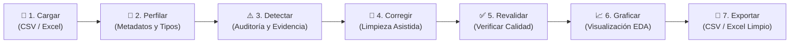

# Especificación Técnica: Aplicación de Perfilado, Limpieza y Visualización de Datasets

> **Guía Maestra de Arquitectura, Requisitos y Flujo de Desarrollo**  
> **Stack:** Python 3.10+ | Streamlit | Pandas | NumPy | Plotly | OpenPyXL  
> **Patrón Arquitectónico:** Arquitectura en Capas (Separación estricta entre Presentación y Lógica de Negocio)

---

## 1. Aclaración Arquitectónica: ¿Requiere Frontend y Backend?

Una duda fundamental antes de escribir código: **¿Se debe desarrollar un backend y un frontend independientes?**

* **A nivel de infraestructura (NO):** No es necesario crear dos aplicaciones separadas (por ejemplo, una API REST en FastAPI/Node.js y una interfaz en React/Vue). Todo el proyecto corre sobre el ecosistema de **Streamlit** en Python.
* **A nivel de diseño de software (SÍ):** El proyecto **exige una separación estricta de responsabilidades en capas**:
  * **Capa de Presentación (Frontend en `app.py`):** Maneja la interfaz de usuario con Streamlit (widgets, selectores, tablas interactivas, métricas, pestañas y renderizado de gráficos). **No debe contener lógica de limpieza ni algoritmos de análisis.**
  * **Capa de Servicios / Negocio (Backend modular en `services/`):** Funciones puras de Python que leen datos, auditan calidad, aplican transformaciones y generan figuras. Son independientes de Streamlit y pueden probarse de forma aislada.

---

## 2. Visión y Principios del Proyecto

La aplicación tiene como objetivo resolver el problema real de la calidad de datos: **"¿Podemos confiar en los datos antes de analizarlos?"**

### Principios Fundamentales
1. **Primero Calidad, Después Análisis:** Un gráfico puede lucir estético y estar construido sobre datos corruptos o inconsistentes.
2. **Diagnóstico con Evidencia:** La app no solo reporta que "hay 15 errores"; permite inspeccionar la tabla exacta de los registros afectados.
3. **Limpieza Asistida y Controlada:** Ninguna transformación o eliminación destructiva ocurre automáticamente; el usuario decide y confirma.
4. **Trazabilidad e Inmutabilidad:** Cada acción se registra en un historial de cambios (`st.session_state.historial`), y las funciones retornan copias de datos sin mutar los originales en memoria.
5. **Revalidación Continua:** Tras aplicar una corrección, el sistema audita nuevamente el estado del dataset (comparativa Antes vs. Después).

---

## 3. Flujo del Ciclo de Vida del Dato



---

## 4. Estructura de Directorios

```text
proyecto-limpieza-datos/
│
├── app.py                      # Capa Frontend: Interfaz Streamlit, estado de sesión y navegación
├── requirements.txt            # Dependencias del proyecto
├── README.md                   # Documentación general de ejecución
│
├── services/                   # Capa Backend / Lógica de Negocio (desacoplada de Streamlit)
│   ├── __init__.py
│   ├── data_loader.py          # Carga segura, detección de codificación y formatos
│   ├── quality_service.py      # Diagnóstico, perfilado general y detección de anomalías
│   ├── cleaning_service.py     # Transformaciones, imputación, normalización y deduplicación
│   └── chart_service.py        # Generación de visualizaciones interactivas con Plotly
│
└── data/                       # Almacenamiento local de datasets de prueba
    └── dataset_prueba.csv
```

---

## 5. Especificación Detallada de Módulos (Capa de Servicios)

### 5.1. `services/data_loader.py` (Carga y Validación de Archivos)
* **Responsabilidad:** Ingerir archivos CSV o Excel cargados por el usuario, gestionar codificaciones (`utf-8`, `latin-1`), validar separadores y controlar excepciones.
* **Funciones Principales:**
  * `cargar_archivo(uploaded_file) -> pd.DataFrame`: Carga segura con manejo de errores descriptivos.
  * `obtener_resumen_fuente(df) -> dict`: Tamaño en memoria, número de filas y columnas iniciales.

### 5.2. `services/quality_service.py` (Perfilado y Detección de Anomalías)
* **Responsabilidad:** Auditar el DataFrame sin modificarlo. Identificar problemas generales y aplicar reglas de negocio.
* **Funciones Principales:**
  * `perfilar_dataset(df) -> dict`:
    * Total de filas y columnas.
    * Conteo de valores faltantes por columna y porcentaje general.
    * Filas duplicadas totales y por claves candidatas.
    * Tipos de datos detectados y memoria utilizada.
    * Estadísticas descriptivas básicas (numéricas y categóricas).
  * `detectar_problemas(df, reglas_negocio=None) -> dict[str, pd.DataFrame]`:
    * **Faltantes:** Filas con nulos por columna seleccionada.
    * **Duplicados:** Filas exactamente repetidas y claves ID duplicadas.
    * **Valores Fuera de Rango:** Números negativos inválidos (ej. cantidades $\le 0$, precios $\le 0$, calificaciones fuera de escala).
    * **Inconsistencias de Texto:** Espacios en blanco innecesarios, diferencias mayúsculas/minúsculas.
    * **Outliers Estadísticos:** Detección por Rango Intercuartílico (IQR) o Puntuación Z para variables numéricas clave.

### 5.3. `services/cleaning_service.py` (Motor de Transformación y Limpieza)
* **Responsabilidad:** Aplicar transformaciones idempotentes y no destructivas (siempre retorna un `df.copy()`).
* **Funciones Principales:**
  * `eliminar_duplicados(df, subset=None, keep='first') -> tuple[pd.DataFrame, int]`: Elimina duplicados y retorna filas removidas.
  * `imputar_faltantes(df, columna, estrategia, valor_personalizado=None) -> pd.DataFrame`: Estrategias: eliminar filas, media, mediana, moda, o valor fijo.
  * `normalizar_textos(df, columnas, minusculas=True, quitar_espacios=True, quitar_tildes=False) -> pd.DataFrame`: Estandarización de cadenas de texto.
  * `convertir_tipos(df, mapeo_tipos) -> pd.DataFrame`: Casteo seguro de tipos (fecha, entero, float, categoría).
  * `filtrar_o_recortar_outliers(df, columna, lim_inf, lim_sup, accion='filtrar') -> pd.DataFrame`: Tratar anomalías estadísticas confirmadas por el usuario.

### 5.4. `services/chart_service.py` (Visualización Interactiva)
* **Responsabilidad:** Recibir DataFrames limpios y retornar objetos `plotly.graph_objects.Figure` listos para renderizar.
* **Funciones Principales:**
  * `grafico_distribucion(df, columna)`: Histogramas y KDE.
  * `grafico_barras_top(df, columna_cat, columna_num, top_n=10, agregacion='sum')`: Comparativas y rankings.
  * `grafico_dispersion(df, col_x, col_y, col_color=None)`: Correlaciones numéricas.
  * `grafico_caja_outliers(df, columna_num, columna_cat=None)`: Boxplots para análisis de dispersión.
  * `grafico_lineas_tiempo(df, col_fecha, col_num, frecuencia='M')`: Tendencias cronológicas.

---

## 6. Especificación de la Interfaz (`app.py`)

La interfaz de Streamlit debe organizarse mediante un menú lateral (`st.sidebar`) o pestañas (`st.tabs`) para guiar al usuario paso a paso:

1. **Pestaña 1 · Ingesta:** Carga de archivo (`st.file_uploader`), previsualización interactiva de primeras y últimas filas, y dimensiones básicas.
2. **Pestaña 2 · Diagnóstico y Calidad:**
   * Métricas generales en tarjetas (`st.metric`): Filas, Columnas, % Nulos, Duplicados.
   * Matriz de problemas detectados con desglose: Nombre del error, cantidad de casos y botón desplegable (`st.expander`) con la evidencia exacta en tabla.
3. **Pestaña 3 · Limpieza Asistida:**
   * Paneles interactivos por tipo de corrección (Duplicados, Faltantes, Formatos, Textos).
   * Botón de confirmación explícita para cada acción.
   * Registro dinámico del Historial de Operaciones (`st.session_state.historial`).
   * Botón para deshacer o reiniciar al estado original.
4. **Pestaña 4 · Validación (Antes vs. Después):**
   * Comparador lado a lado del estado inicial y el estado actual del dataset.
   * Resumen de errores resueltos vs. pendientes.
5. **Pestaña 5 · Análisis Exploratorio (EDA):**
   * Gráficos interactivos generados por `chart_service.py` embebidos con `st.plotly_chart(fig, use_container_width=True)`.
6. **Pestaña 6 · Exportación:**
   * Resumen técnico final (filas resultantes, columnas preservadas).
   * Botón de descarga (`st.download_button`) en CSV (codificado con `utf-8-sig`) o Excel (`openpyxl`).

---

## 7. Reglas de Negocio: Universales vs. Específicas de Dominio

La aplicación debe estructurarse para admitir dos niveles de reglas:

| Nivel | Tipo de Regla | Ejemplos |
| :--- | :--- | :--- |
| **Universales** *(Aplica a cualquier dataset)* | Integridad estructural | Filas repetidas, celdas vacías (`NaN`/`None`), cadenas con espacios sobrantes, campos numéricos almacenados como texto. |
| **Estadísticas** *(Aplica a cualquier dataset)* | Detección de anomalías | Outliers vía método IQR ($Q_1 - 1.5 \times IQR$ a $Q_3 + 1.5 \times IQR$). |
| **Específicas de Dominio** *(Parametrizables)* | Restricciones lógicas del negocio | Precios $> 0$, porcentajes entre $0$ y $100$, IDs irrepetibles, fechas en rangos válidos. |

> [!TIP]
> Si el limpiador se usa para un dataset específico (ej. ventas veterinarias, animes, inventario), las reglas específicas de negocio se pueden configurar mediante un diccionario o un panel de configuración en la barra lateral.

---

## 8. Guía de Construcción Paso a Paso (Roadmap Modular)

Para garantizar un código limpio, la construcción debe realizarse módulo por módulo:

* [ ] **Fase 1: Andamiaje y Entorno:** Crear estructura de carpetas, entorno virtual (`.venv`) e instalar dependencias (`requirements.txt`).
* [ ] **Fase 2: Carga Segura (`services/data_loader.py`):** Lectura robusta de CSV y carga en `st.session_state`.
* [ ] **Fase 3: Diagnóstico y Perfilado (`services/quality_service.py`):** Cálculo de métricas y detección de registros problemáticos con evidencia visual.
* [ ] **Fase 4: Motor de Limpieza Asistida (`services/cleaning_service.py`):** Deduplicación, imputación de nulos, estandarización de textos y casting de tipos con confirmación de usuario.
* [ ] **Fase 5: Trazabilidad y Revalidación:** Control de cambios en `st.session_state.historial` y auditoría comparativa.
* [ ] **Fase 6: Visualizaciones Interactivas (`services/chart_service.py`):** Gráficos Plotly desacoplados del flujo de limpieza.
* [ ] **Fase 7: Módulo de Exportación:** Descarga del dataset transformado listo para producción.
